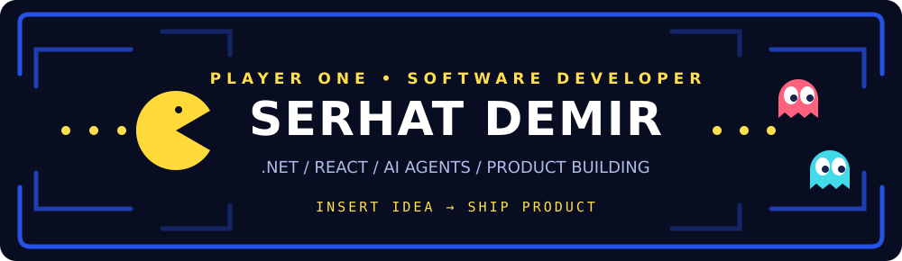

<div align="center">



### 🟡 LEVEL 01 · HELLO, WORLD!

**Full Stack Developer · Enterprise Backend · AI-Powered Products**

I build production-ready software, from enterprise APIs to AI agents and mobile games.

[](https://imserhatdemir.com)
[](https://www.linkedin.com/in/demirserhat/)
[](mailto:serhatdemir1235@gmail.com)


</div>

---

### 👾 LEVEL 02 · THE PLAYER

```text
> PLAYER        Serhat Demir
> CLASS         Full Stack Developer
> MAIN QUEST    Build useful, scalable products
> POWER-UPS     C# / .NET / React / PostgreSQL / AI
> SIDE QUEST    Mobile games & open-source experiments
> LOCATION      Istanbul, Türkiye
```

My focus is **C#/.NET backend engineering, React applications, enterprise integrations, and practical AI**. I enjoy taking a product from the initial idea through architecture, implementation, and launch.

### 🟡 LEVEL 03 · POWER-UPS

<div align="center">

**⚙️ BACKEND & DATA**


**🎮 FRONTEND & MOBILE**


**🤖 AI / LLM / AGENTS**


**🛠️ TOOLS & WORKFLOW**


<sub>Also working with ASP.NET Core, Blazor, React Native / Expo, SQL Server, Entity Framework Core, Dapper, REST APIs and local AI inference workflows.</sub>

</div>

### 👻 LEVEL 04 · SELECT YOUR QUEST

| Quest | What I'm building | Stack |
| :-- | :-- | :-- |
| **[Dotkesk](https://dotkesk.com)** | Conversational commerce platform with AI agents, omnichannel messaging, automations and store integrations | .NET · React · PostgreSQL · AI |
| **[ft-motion](https://github.com/imserhatdemir/ft-motion)** | Open-source motion graphics experiments and tooling | TypeScript · Three.js · AI |
| **Mobile games** | Puzzle and casual game experiences, from prototypes to published apps | Godot · React Native · iOS / Android |
| **Enterprise systems** | APIs, business integrations, customer platforms, reporting and automation | C# · ASP.NET Core · Blazor · SQL Server |

<div align="center">

### 🏆 LEVEL 05 · SCOREBOARD


### 🟡 READY PLAYER TWO?

**Have a product idea, engineering challenge, or open-source collaboration in mind?**

[](mailto:serhatdemir1235@gmail.com)

<sub>GAME NOT OVER · KEEP BUILDING · KEEP LEARNING</sub>

</div>
